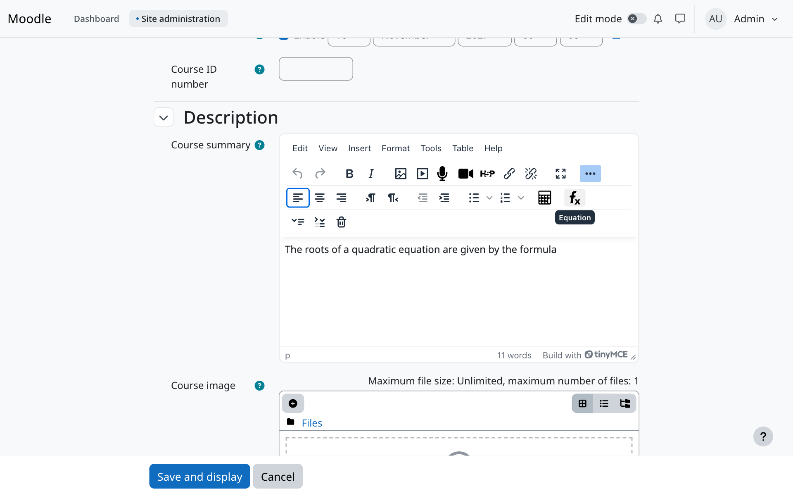
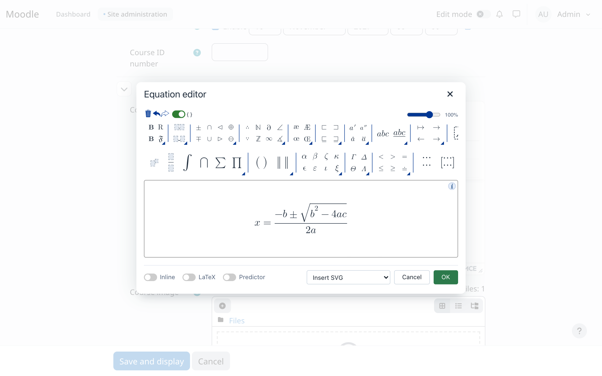
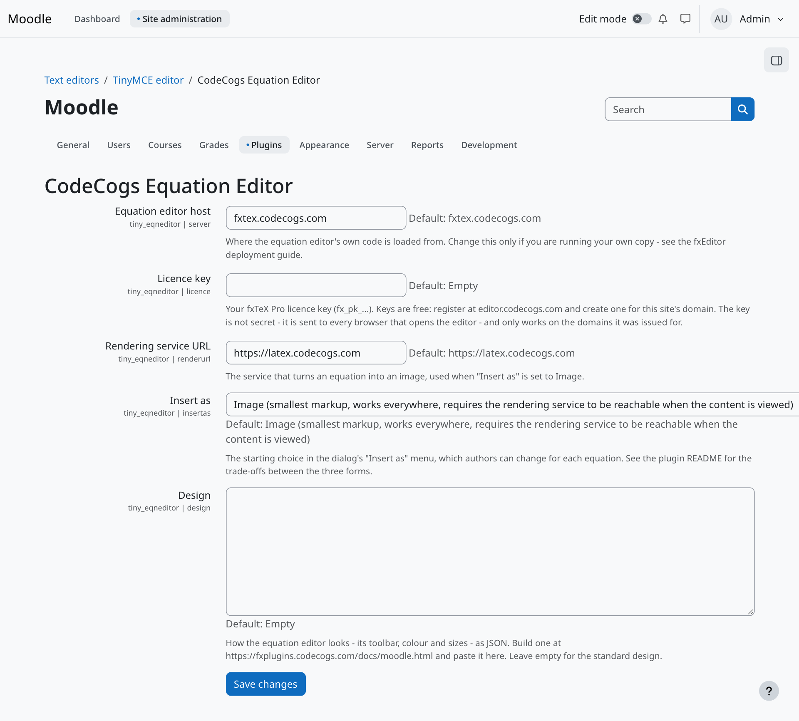

# fxEditor for Moodle (tiny_eqneditor)

The fxEditor plugin for Moodle adds an **Equation** button to Moodle's TinyMCE editor, so
teachers and students can write mathematics anywhere Moodle has a text editor - a quiz question,
a forum post, a page, an assignment. The button opens fxEditor, CodeCogs' equation editor: a
toolbar of symbols and structures, a what-you-see-is-what-you-get maths view, and the LaTeX
source beside it. The equation goes into the content as an image, as LaTeX for Moodle's MathJax
filter, or as MathML, and a double-click on an inserted equation opens it again for editing.

In Moodle the plugin is called **CodeCogs Equation Editor**; its component is `tiny_eqneditor`,
and it installs to `lib/editor/tiny/plugins/eqneditor`. It needs Moodle 4.1 or later (the
release that introduced the TinyMCE editor) and has been tested on Moodle 5.3 and 4.5 LTS.

## Screenshots



*The **Equation** button on Moodle's TinyMCE toolbar.*



*The equation editor dialog.*

## Links

- Documentation and live demo: https://fxplugins.codecogs.com/docs/moodle.html
- Customise and download: https://fxplugins.codecogs.com/docs/moodle.html#customise
- All fxEditor plugins: https://fxplugins.codecogs.com
- fxEditor: https://fxeditor.codecogs.com

## Installing

The plugin includes its compiled JavaScript, so there is no build step, and it needs no other
plugins and no Composer.

### From git

Clone the repository into your Moodle's TinyMCE plugins folder, as `eqneditor`:

```bash
cd <moodle>
git clone https://github.com/willzyba/moodle-tiny_eqneditor.git lib/editor/tiny/plugins/eqneditor
```

(On Moodle 5.1 and later, whose code is under `public/`, the folder is
`<moodle>/public/lib/editor/tiny/plugins/eqneditor`.)

Then visit *Site administration > Notifications* to complete the install.

### From the plugin ZIP

*Site administration > Plugins > Install plugins*, upload the ZIP, and follow the prompts. (Or
unzip it so that its `eqneditor` folder is `<moodle>/lib/editor/tiny/plugins/eqneditor`, then
visit *Site administration > Notifications*.)

### Then

1. Under *Site administration > Plugins > Text editors > TinyMCE editor > CodeCogs Equation
   Editor*, enter your **licence key** (see [Licence key](#licence-key)). This is the one step
   the plugin needs after installation.
2. Optionally, paste a design - the `design.json` from
   [Customise and download](https://fxplugins.codecogs.com/docs/moodle.html#customise) - into
   **Design** on the same page.

The **Equation** button then appears on the editor's toolbar, and under *Insert > Equation...*.

## Licence key

Equations are rendered by fxTeX Pro, which needs a licence key for your site's domain. Get one
from https://fxeditor.codecogs.com/purchase: a 30-day trial key to try it, then a purchased key
to keep using it. A key only works on the domains it was issued for. It is not a secret -
it is sent to every browser that opens the editor.

Without a key the editor opens and equations can still be written in LaTeX and inserted as
images, but the maths view shows an fxTeX Pro error instead of the equation, and MathML inserts
are not available.

Enter the key under *Site administration > Plugins > Text editors > TinyMCE editor > CodeCogs
Equation Editor > Licence key*:



*The plugin's settings page: the Equation editor URL and the Rendering service URL, both `https://fxtex.codecogs.com`, and the Licence key field.*

### Settings

Site-wide, on the same page:

| Setting | Default | Meaning |
|---|---|---|
| Licence key | *(empty)* | Your fxTeX Pro licence key (`fx_pk_...`) - a 30-day trial or a purchased key. Required. |
| Design | *(empty)* | How the editor looks, as JSON: dialog width, height and scale, toolbar panels and size, colour, equation and markup sizes, undo/redo. Build one in [Customise and download](https://fxplugins.codecogs.com/docs/moodle.html#customise). Empty for the standard design. |
| Equation editor URL | `https://fxtex.codecogs.com` | Where the equation editor is loaded from. Change it only if you run your own copy. |
| Rendering service URL | `https://fxtex.codecogs.com` | The service that turns an equation into an image, used when *Insert as* is *Image*. |
| Insert as | Image | The dialog's starting *Insert as* choice - Image, LaTeX or MathML - which authors can change for each equation. |

### Choosing how equations are stored

- **Image** (an SVG ``) - displays anywhere, but fxtex.codecogs.com has to be reachable
  whenever the content is viewed.
- **LaTeX** - `\( \)` when *Inline* is on, `$$ $$` otherwise. Compact and editable by hand;
  displayed by Moodle's MathJax filter, which must be enabled where the content is shown.
- **MathML** - final markup with nothing to fetch. Pages that display it need fxTeX's
  stylesheet, since browsers' own MathML does not cover everything the converter produces: add
  `<link id="fxtex-style" rel="stylesheet" href="https://fxtex.codecogs.com/fxtex.css">` under
  *Site administration > Appearance > Additional HTML > Within HEAD*. That also reaches pages
  with the editor on them, and the `id` is the one fxTeX Pro looks for, so those pages are not
  given a second copy. The plugin loads it into the editing area's iframe itself, but cannot
  reach every page that later shows the content.

## Licence

Copyright (c) 2026 CodeCogs, Zyba Ltd.

This plugin is free software under the GNU General Public License, version 3 or later, as Moodle
requires of its plugins - see
[`LICENSE`](https://github.com/willzyba/moodle-tiny_eqneditor/blob/main/LICENSE). It contains no
third-party code: the equation editor and fxTeX Pro are not part of this package, and are
loaded from fxtex.codecogs.com at run time under CodeCogs' own terms.

## External services

This plugin is a front end to one service run by CodeCogs, **fxtex.codecogs.com**, and does not
work without it.

| What fxtex.codecogs.com does | What it receives |
|---|---|
| Serves the equation editor itself (`fxeditor.api.min.js`, `fxeditor.css`, fonts) and fxTeX Pro, the typesetting engine that draws the maths view and converts equations to MathML - the author's browser loads them each time the editor opens. And draws the equations inserted as **images**: each image's address carries its LaTeX, and every browser that displays the image fetches it from there (LaTeX and MathML inserts do not use this). | The site's licence key; the address of the Moodle page (as the browser's referrer); the LaTeX of each equation inserted as an image. Each opening of the editor, and each image drawn, is recorded as use against the site's licence. |

The *Equation editor URL* and *Rendering service URL* settings both point at it; they are separate
only so a site running its own fxTeX Server can point them there.

The plugin stores no personal data in Moodle; its privacy provider declares fxtex.codecogs.com
as its one external service.

## The dialog

The toolbar and maths view on top; one bottom bar with the *Inline* and *LaTeX* switches on the
left and *Insert as*, *Cancel* and *OK* on the right. *LaTeX* shows the LaTeX source above the
maths view. The dialog remembers its layout choices (toolbar size, the switches, the panes'
sizes) in the author's own browser only.

## For developers

```
version.php                    Plugin version and requirements.
settings.php                   Site admin settings.
classes/plugininfo.php         Registers the button and menu item, and passes the settings to
                                the AMD module.
classes/privacy/provider.php   Privacy API: no data kept in Moodle; fxtex.codecogs.com, its one external service.
lang/en/tiny_eqneditor.php     English strings.
pix/eqneditor.svg              The toolbar button's icon.
amd/src/plugin.js              Entry point - registers with TinyMCE's PluginManager.
amd/src/configuration.js       Puts the button on the toolbar and in the Insert menu.
amd/src/commands.js            The button, the menu item and the dialog itself.
amd/src/options.js             Reads plugininfo.php's configuration back out of the editor.
amd/src/common.js              Shared constants.
amd/build/                     The compiled modules Moodle loads - rebuild after changing amd/src.
screenshots/                   For this README; not included in the plugin ZIP.
```

The dialog is the same code as `tinymce/v6/eqneditor.js` in the fxPlugins repository, adapted
to Moodle's plugin API; keep the two in step by hand.

Rebuilding `amd/build` needs Moodle's own Grunt set-up and Node 22, from a Moodle checkout with
the plugin in place:

```
cd <moodle>
npx grunt amd --root=lib/editor/tiny/plugins/eqneditor
```

(With a different Node on the machine: `docker run --rm -v "$PWD:/moodle" -w /moodle node:22 npx
grunt amd --root=lib/editor/tiny/plugins/eqneditor`.)
